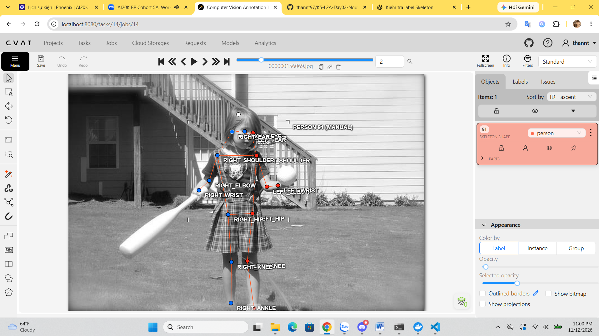
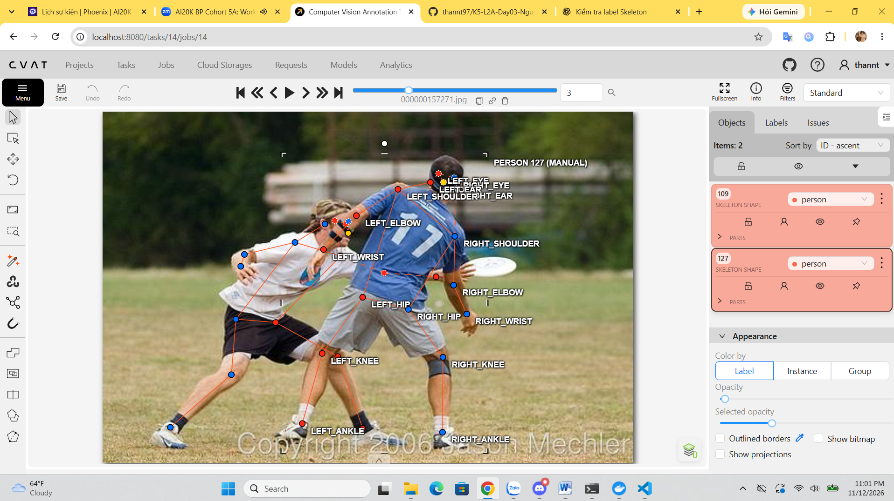
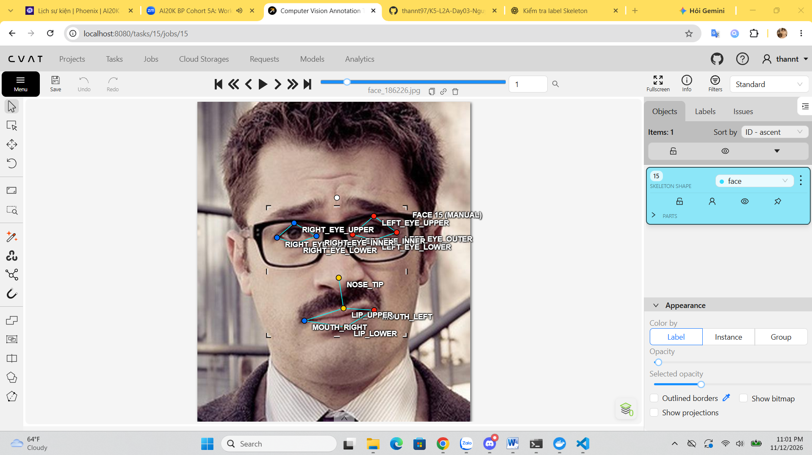
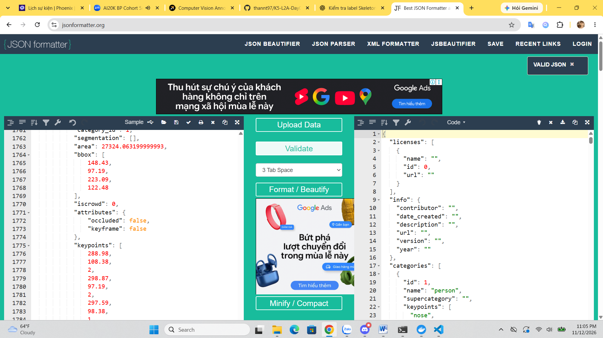

# Báo cáo cá nhân — HoVaTen-MSSV

Đổi tên file theo quy tắc `MSSV_HoTen.md`. Ví dụ: `20241234_NguyenVanAn.md`.

Dữ liệu: 12 ảnh người COCO val2017 (Lin et al., 2014) và 8 ảnh chân dung Wikimedia Commons, chỉ dùng trong lớp.

## 0. Thông tin học viên

- Họ tên: Nguyễn Thanh Thản
- MSSV:2A202603202
- Email:npc12a1@gmail.com
- Link repository:https://github.com/thannt97/K5-L2A-Day03-NguyenThanhThan-2A202603202-KeypointPose-Student
- Phiên bản CVAT (Help → About): 2.82.1
- Máy: hệ điều hành windown11 · RAM 32 GB · chạy CVAT chế độ đầy đủ
- Bộ ảnh (`src/exports/assignment.json` do `lab.py setup` tạo): có
- Giờ bắt đầu: 16:30
- Giờ kết thúc: 23:00

## 1. Kiểm tra label (CP0)

| Label | Kiểu | Số điểm | Tên điểm đúng bảng của lab? | Đúng thứ tự? | Số cạnh |
|---|---|---:|---|---|---:|
| `person` | Skeleton | 17 | | | |
| `face` | Skeleton | 13 | | | |

Mẫu `person` dựng theo người quay mặt về camera (các điểm `left_*` nằm bên phải khung mẫu)? Có

Cách đổi cờ `occluded` / `outside` cho **một điểm** trên phiên bản CVAT này (một câu):
Chọn riêng keypoint cần chỉnh trên ảnh, mở bảng thuộc tính của điểm và bật/tắt cờ Occluded hoặc Outside tương ứng.

## 2. Số lượng đã gán và thời gian (CP1, CP2)

| Nhóm ảnh | Số ảnh | Số skeleton đã gán | Số người dưới 60 px (không gán) | Số poster / gương / màn hình bỏ qua | Thời gian (phút) |
|---|---:|---:|---:|---:|---:|
| `easy` | 5 | 6 | 0 | 0 | 30 |
| `occluded` | 3 | | | | |
| `back` | 2 | 2 | 0 | 0 | 20p |
| `small` | 1 | 3 | 0 | 0 | 15p |
| `crowd` | 1 | 3 | 8 | 1 | 20p |
| `faces` | 8 | 8b| — | 0 | 60p |

- Số ảnh người đã xong ở mốc phút 105: 9 / 10
- Thời gian thực tế (phút): CP1 20 · CP2 35 · CP3 50
- Ảnh tốn thời gian nhất là ảnh nào, vì sao?
ảnh 000000106051.jpg
vì ảnh người nhỏ, bị che khuất khá nhiều.

## 3. Bảng ca khó (CP1, CP2)

Mỗi điểm bạn phân vân một dòng, nhất là phân vân giữa `v = 1` và `v = 0`, hoặc không chắc hướng người.

| Ảnh | Người / mặt | Điểm | Cờ đã chọn | Phân vân giữa | Lý do chọn |
|---|---|---|---:|---|---|
| 000000106051.jpg | Người | right_knee | occluded | occluded/outside| có thể phán đoán khá chắc chắn|
| 000000332273.jpg | Người | right_ankle, right_knee | outside | occluded/outside| không phán đoán chắc chắc được vị trí|
| 000000461002.jpg | Người | left_eye, right_eye | occluded | occluded/outside| không thể phán đoán được vị trí|

## 4. Bảng tự review (CP3)

Đi từ ảnh cuối về ảnh đầu. 5 ảnh người (ít nhất 2 ảnh `back` hoặc `crowd`) và 3 ảnh mặt. Ít nhất 8 dòng, kể cả dòng `ok`. Ghi lỗi trước, sửa sau.

Mã lỗi dùng đúng một trong: `lr_swap`, `vis_flag`, `position`, `missing`, `extra`, `ok`.

| Ảnh | Người / mặt | Điểm | Mã lỗi | Ghi chú | Đã sửa? |
|---|---|---|---|---|---|
| 000000164659.jpg | người | knee, ankle| lr_swap | Có khả năng nhầm trái/phải | không |
| 000000157271.jpg | người | knee, ankle| lr_swap | Có khả năng nhầm trái/phải | không |
| 000000571665.jpg | người | knee, ankle| vis_flag | Vị trí có thể không đúng giữa | có |
| 000000332273.jpg | người | knee, ankle| position | Điểm mũi lệch khỏi vị trí thực tế | có |
| 000000433787.jpg | người | knee, ankle| vis_flag | Chưa thống nhất cờ hiển thị | có |
| 000000164659.jpg | người | knee, ankle| missing | 	Thiếu keypoint cổ tay | có |
| 000000220045.jpg | người | knee, ankle| position | Điểm mắt cá đặt chưa chính xác | có |

Tổng hợp số lỗi theo mã:

| `lr_swap` | `vis_flag` | `position` | `missing` | `extra` | `ok` |
|---:|---:|---:|---:|---:|---:|
| 2 | 2 | 2 | 1 | 0 | 0 |

Điểm còn phân vân giữa `v = 1` và `v = 0` (ghi cả hai lựa chọn và lý do chọn):
không còn

## 5. Kiểm file xuất và kết quả tự kiểm (CP4)

Tự kiểm tay trong file JSON:

| File | Người / mặt kiểm (ảnh, thứ tự) | Số phần tử `keypoints` | Điểm `outside` ra `v = 0`, `occluded` ra `v = 1`? | `num_keypoints` khớp? |
|---|---|---:|---|---|
| `HoVaTen_persons.zip` | người | 357 | 81, 40 | 236 |
| `HoVaTen_faces.zip` | mặt | 104 | 9, 0| 95 |

Sau khi xuất, CVAT ghi `occluded` thành `v = 1` và `outside` thành `v = 0`. Tọa độ của điểm `outside` trong file là `0, 0` hay tọa độ cũ? 
v = 0 không tự động có nghĩa tọa độ phải là (0, 0).
Hai job đã chuyển sang completed trên CVAT? Có / Không: Có

Dán phần **TÓM TẮT** in ra từ `src/check_submission.py`:

```text
(dán ở đây)
- File person: NguyenThanhThan_persons.zip
  Số ảnh: 12 · số skeleton `person`: 21 · mỗi annotation 51 số
  Skeleton theo ảnh: 000000069971=2, 000000106051=3, 000000156069=1, 000000157271=2, 000000164659=1, 000000220045=2, 000000332273=3, 000000433787=1, 000000445187=1, 000000455536=1, 000000461002=2, 000000571665=2
  Cờ v: v=2 236 (66%) · v=1 81 (23%) · v=0 40 (11%)
  num_keypoints trung bình: 15.1
- Ghi chú: 40 điểm v = 0 vẫn mang tọa độ cũ (CVAT 2.x xuất như vậy; chuẩn COCO ghi 0, 0). Không phải lỗi: điểm v = 0 bị bỏ qua khi huấn luyện và khi chấm.
- Số [LỖI]: 0 · số [CẢNH BÁO]: 4

Các `[CẢNH BÁO]` còn giữ nguyên và lý do:
 [CẢNH BÁO] 000000164659.jpg #1: cặp knee, ankle nằm ngược phía so với các cặp còn lại. Có thể đổi trái/phải một cặp (`lr_swap`), hoặc tay / chân bắt chéo thật: kiểm lại.
  [CẢNH BÁO] 000000220045.jpg #2: cặp elbow nằm ngược phía so với các cặp còn lại. Có thể đổi trái/phải một cặp (`lr_swap`), hoặc tay / chân bắt chéo thật: kiểm lại.
  [CẢNH BÁO] 000000332273.jpg #2: cặp ankle nằm ngược phía so với các cặp còn lại. Có thể đổi trái/phải một cặp (`lr_swap`), hoặc tay / chân bắt chéo thật: kiểm lại.
  [CẢNH BÁO] 000000461002.jpg #1: cặp hip, knee, ankle nằm ngược phía so với các cặp còn lại. Có thể đổi trái/phải một cặp (`lr_swap`), hoặc tay / chân bắt chéo thật: kiểm lại.

## 6. Ảnh chụp màn hình

1. Label `person` trong label constructor (đủ 17 điểm có tên):

   

2. Một người quay lưng đã gán, cờ đã đặt:

   

3. Một khuôn mặt đã gán 13 điểm, phóng to vùng mắt:

   

4. Một đoạn JSON xuất của một người:

   

Nguồn ảnh: COCO val2017 / Wikimedia Commons.

## 7. Tự đánh giá

1. Lỗi bạn mắc nhiều nhất hôm nay, và cách bạn sẽ tránh ở dự án thật:
 Lỗi tôi mắc nhiều nhất là phán đoán trạng thái visibility chưa chính xác, đặc biệt là chọn cờ occluded khi chưa chắc chắn điểm đó có thực sự bị che khuất hay không.

Cách khắc phục:
- Đọc kỹ guideline trước khi bắt đầu gán nhãn.
- Phân biệt rõ visible, occluded và outside.
- Không tự suy đoán vị trí keypoint khi không có đủ bằng chứng.
- Đánh dấu các trường hợp chưa chắc chắn để hỏi người kiểm duyệt.
- Kiểm tra lại các điểm có visibility không rõ trước khi xuất dữ liệu.

2. Một quy tắc bạn đề xuất thêm vào guideline (kèm ảnh ví dụ nếu có):
Cần phân biệt:
- visible: Điểm nhìn thấy được.
- occluded: Điểm tồn tại nhưng bị vật thể khác che khuất.
- outside: Điểm nằm ngoài khung hình.
- Nếu không xác định được trạng thái, ghi nhận để người kiểm duyệt quyết định, không tự ý phán đoán.

3. Nhãn của bạn đi vào model ở đâu? Chọn một lỗi bạn đã sửa và nói nó sẽ làm model học sai thế nào (heatmap, trọng số trong loss, hay bước lật ảnh):
hãn Skeleton được sử dụng trong quá trình huấn luyện mô hình Pose Estimation.

Ví dụ lỗi tôi đã sửa: Nhầm left_wrist thành right_wrist (lr_swap).

Lỗi này có thể khiến model học sai như sau:
1. Heatmap: Model được huấn luyện để dự đoán vị trí cổ tay trái tại vị trí thực tế của cổ tay phải.
2. Loss: Sai lệch giữa heatmap dự đoán và heatmap Ground Truth làm tăng loss, tạo tín hiệu học không chính xác cho nhánh keypoint tương ứng.
3. Flip augmentation: Khi lật ảnh ngang, nhãn trái/phải cần được hoán đổi đúng. Nếu nhãn ban đầu đã sai, quá trình lật ảnh có thể tiếp tục củng cố sự nhầm lẫn.

## 8. Khó khăn và lỗi kỹ thuật
1. Khó xác định hướng trái/phải: Khi người quay lưng (back), quay nghiêng hoặc xuất hiện trong đám đông (crowd), dễ nhầm lẫn giữa left_* và right_*.

2. Khó xác định trạng thái visibility: Chưa phân biệt chắc chắn giữa visible, occluded và outside, đặc biệt khi keypoint bị che khuất một phần.

3. Khó đặt vị trí keypoint: Một số điểm như cổ tay, mắt cá chân, tai và mắt khó xác định chính xác khi ảnh mờ, người ở xa hoặc bị che khuất.

4. Khó thao tác với Skeleton trên CVAT: Việc chọn từng keypoint, chỉnh tọa độ và thay đổi cờ occluded / outside đôi khi chưa thuận tiện, dễ thao tác nhầm điểm.

## Bonus (nếu làm)

### B1 — 3 ảnh người khó thêm

| Ảnh | Số skeleton | Số người dưới 60 px | Ca khó nhất |
|---|---:|---:|---|
| 000000005294 | 3 | 10 | người ngồi ngữa và bị tờ báo che|
| 000000357549 |3 | 0 | người phụ nữ mặc váy bị xe đạp và chiếc váy khó xác định keypoint|
| 000000465508 | 3 | 0 | người phụ nữ bị khuất 1 phần |

Kết quả `src/check_submission.py` cho `HoVaTen_bonus_persons.zip`:

```text
(dán ở đây)
- File person: NguyenThanhThan_bonus_persons.zip
  Số ảnh: 3 · số skeleton `person`: 9 · mỗi annotation 51 số
  Skeleton theo ảnh: 000000005294=3, 000000357549=3, 000000465508=3
  Cờ v: v=2 80 (52%) · v=1 19 (12%) · v=0 54 (35%)
  num_keypoints trung bình: 11.0
- Ghi chú: 54 điểm v = 0 vẫn mang tọa độ cũ (CVAT 2.x xuất như vậy; chuẩn COCO ghi 0, 0). Không phải lỗi: điểm v = 0 bị bỏ qua khi huấn luyện và khi chấm.
- Số [LỖI]: 0 · số [CẢNH BÁO]: 2
Kết quả: ĐẠT (đọc lại từng cảnh báo ở trên)

### B2 — 5 ảnh khuôn mặt đen trắng / hồng ngoại

Ảnh không màu khó hơn ở điểm nào? Kính râm trên ảnh hồng ngoại có còn là `v = 1` không?
Ảnh đen trắng và ảnh hồng ngoại gây khó khăn hơn khi gán nhãn Skeleton Face vì thiếu thông tin màu sắc và độ tương phản giữa các bộ phận trên khuôn mặt.
Có thể là v = 1.

Cần căn cứ vào khả năng nhìn thấy vị trí keypoint, không căn cứ đơn thuần vào việc người đó có đeo kính hay không.

### B3 — Model so với nhãn của tôi (không tính điểm)

- Demo đã dùng: Demo Pose Estimation (YOLO Pose / COCO Keypoints).
- Ảnh đã thử: 000000465508.jpg

1. Model có trả điểm cho khớp bị che, hay khớp ngoài ảnh không? Confidence ở các điểm đó thế nào?
Model vẫn có thể dự đoán tọa độ cho các khớp bị che khuất hoặc nằm ngoài ảnh, tùy kiến trúc và cách xử lý của model.

2. Với người quay lưng, model có đổi trái/phải không?
Model thường vẫn duy trì quy ước trái/phải theo cấu trúc cơ thể người, không đơn giản đổi nhãn theo phía trái/phải của khung hình.

Tuy nhiên, khi người quay lưng, quay nghiêng hoặc bị che khuất, model có thể nhầm left_* và right_* do thiếu thông tin hình ảnh.

3. Bộ điểm của model có giống 17 điểm COCO không?
Nếu sử dụng model YOLO Pose được huấn luyện theo bộ dữ liệu COCO Keypoints thì bộ điểm chuẩn gồm 17 keypoints
## 9. Tài liệu tham khảo và công cụ AI đã dùng
Ultralytics YOLO Pose:	Demo nhận diện tư thế người
COCO Keypoints:	Tham khảo quy chuẩn 17 keypoints
ChatGPT:	Hỗ trợ tìm hiểu guideline, visibility, kiểm tra lỗi và giải thích kết quả
